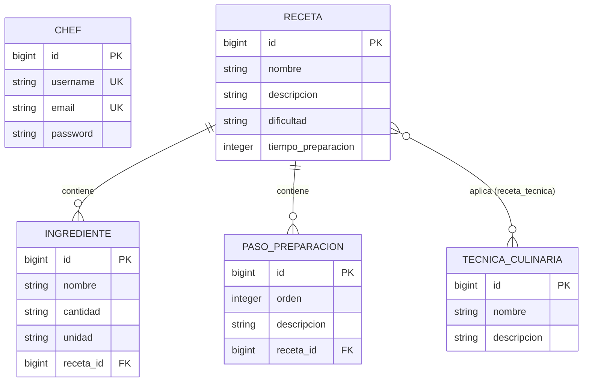

# Plataforma de Diseño de Recetas y Técnicas Culinarias

## 1. Descripción general del proyecto
API REST desarrollada con **Spring Boot** diseñada para que chefs y estudiantes de gastronomía puedan documentar, construir y consultar recetas paso a paso. El sistema permite registrar preparaciones base con ingredientes y pasos de preparación, enriquecerlas aplicando diferentes técnicas culinarias mediante una relación **Muchos a Muchos (`@ManyToMany`)**, proteger las operaciones mediante **autenticación JWT** y explorar/probar todos los endpoints desde **Swagger UI (OpenAPI 3)**.

## 2. Lista de integrantes del equipo
* Morales Franco Clara Zairy
* Mendoza Vásquez Manuel Heyoan

## 3. Tabla de requerimientos

| # | Requerimiento | Endpoint | Seguridad |
| :-: | :--- | :--- | :---: |
| 1 | **Registrar Receta Base** (con ingredientes, pasos y técnicas) | `POST /recetas` | JWT |
| 2 | **Consultar Catálogo** completo de recetas | `GET /recetas` | JWT |
| 3 | **Búsqueda por ID** de una receta específica | `GET /recetas/{id}` | JWT |
| 4 | **Añadir / Gestionar Técnicas Culinarias** (`@ManyToMany`) | `POST /api/tecnicas`, `POST /recetas/{recetaId}/tecnicas/{tecnicaId}` | JWT |
| 5 | **Actualizar Parámetros** (dificultad, tiempo de preparación, ingredientes y pasos) | `PUT /recetas/{id}` | JWT |

## 4. Funcionalidades implementadas con Spring Boot
* **Autenticación y Seguridad JWT (`spring-boot-starter-security` + `jjwt`):** Registro (`/auth/register`) e inicio de sesión (`/auth/login`) públicos, contraseñas cifradas con `BCryptPasswordEncoder`, sesiones `STATELESS`, filtro `JwtAuthenticationFilter` y bloqueo (`401 Unauthorized`) en rutas protegidas sin token válido.
* **Persistencia JPA / H2 (`spring-boot-starter-data-jpa` + `h2`):** Almacenamiento relacional en memoria (`jdbc:h2:mem:recetas`) con relaciones `@OneToMany` (`Receta` -> `Ingrediente` y `PasoPreparacion`) y `@ManyToMany` (`Receta` <-> `TecnicaCulinaria` mediante la tabla intermedia `receta_tecnica`).
* **Documentación interactiva OpenAPI / Swagger (`springdoc-openapi-starter-webmvc-ui`):** Interfaz en `/swagger-ui/index.html` con esquema de seguridad `bearerAuth` para probar endpoints protegidos directamente desde el navegador.
* **Soporte CORS:** Habilitado en `SecurityConfig` para permitir el consumo desde aplicaciones frontend externas.

## 5. Relaciones entre modelos

Cada receta contiene múltiples ingredientes y pasos de preparación (`@OneToMany`), y puede asociarse con múltiples técnicas culinarias que a su vez pueden reutilizarse en varias recetas (`@ManyToMany` con `@JoinTable(name = "receta_tecnica")`). Los chefs se almacenan en la tabla `chefs` para la autenticación JWT.



## 6. Cómo compilar y ejecutar el proyecto

### Requisitos previos
* Java 17 o superior (compatible con Java 17 / 21 / 25+)

### Compilación limpia y pruebas
Desde la raíz del repositorio:

```bash
cd api-recetas
```

En **Linux / macOS / DevContainer**:
```bash
./mvnw clean compile
./mvnw test
./mvnw spring-boot:run
```

En **Windows (PowerShell / CMD)**:
```powershell
.\mvnw.cmd clean compile
.\mvnw.cmd test
.\mvnw.cmd spring-boot:run
```

El servidor iniciará en `http://localhost:8080`.

## 7. Guía rápida de pruebas con Swagger y JWT

1. Abre Swagger UI en: `http://localhost:8080/swagger-ui/index.html`
2. Registra un chef en **`POST /auth/register`**:
   ```json
   {
     "username": "chef_demo",
     "email": "chef@ejemplo.com",
     "password": "MiPassword123"
   }
   ```
3. Copia el valor del campo `token` devuelto por `/auth/register` (o inicia sesión en **`POST /auth/login`**).
4. En Swagger UI, haz clic en el botón **Authorize** (candado superior derecho), pega únicamente el token JWT en el esquema **`bearerAuth`** y confirma.
5. Ahora puedes probar los endpoints protegidos:
   * Crear una técnica culinaria en **`POST /api/tecnicas`**:
     ```json
     {
       "nombre": "Salteado",
       "descripcion": "Cocción rápida a fuego alto con poco aceite en sartén."
     }
     ```
   * Crear una receta en **`POST /recetas`** (asociando técnicas nuevas o existentes por `id`):
     ```json
     {
       "nombre": "Pasta al pesto",
       "descripcion": "Receta de pasta con pesto casero",
       "dificultad": "Media",
       "tiempoPreparacion": 25,
       "ingredientes": [
         {
           "nombre": "Pasta",
           "cantidad": "200",
           "unidad": "gramos"
         }
       ],
       "pasos": [
         {
           "orden": 1,
           "descripcion": "Hervir la pasta al dente"
         }
       ],
       "tecnicasCulinarias": [
         {
           "id": 1
         }
       ]
     }
     ```
   * Consultar todas las recetas en **`GET /recetas`** o asociar otra técnica existente mediante **`POST /recetas/{recetaId}/tecnicas/{tecnicaId}`**.

## 8. Resumen de endpoints

| Método | Ruta | Acceso | Descripción |
| :--- | :--- | :---: | :--- |
| `GET` | `/` | Público | Verificación de estado de la API |
| `GET` | `/swagger-ui/index.html` | Público | Documentación interactiva Swagger UI |
| `GET` | `/v3/api-docs` | Público | Especificación OpenAPI 3 en JSON |
| `POST` | `/auth/register` | Público | Registro de chef (cifrado BCrypt + JWT) |
| `POST` | `/auth/login` | Público | Inicio de sesión y emisión de JWT |
| `GET` | `/recetas` | JWT | Listar todas las recetas |
| `GET` | `/recetas/{id}` | JWT | Consultar receta por ID |
| `POST` | `/recetas` | JWT | Crear receta con ingredientes, pasos y técnicas |
| `PUT` | `/recetas/{id}` | JWT | Actualizar parámetros y colecciones de una receta |
| `DELETE` | `/recetas/{id}` | JWT | Eliminar una receta |
| `POST` | `/recetas/{recetaId}/tecnicas/{tecnicaId}` | JWT | Asociar técnica culinaria a receta (`@ManyToMany`) |
| `DELETE` | `/recetas/{recetaId}/tecnicas/{tecnicaId}` | JWT | Desasociar técnica culinaria de receta |
| `GET` | `/api/tecnicas` | JWT | Listar técnicas culinarias |
| `GET` | `/api/tecnicas/{id}` | JWT | Consultar técnica culinaria por ID |
| `POST` | `/api/tecnicas` | JWT | Crear técnica culinaria |
| `PUT` | `/api/tecnicas/{id}` | JWT | Actualizar técnica culinaria |
| `DELETE` | `/api/tecnicas/{id}` | JWT | Eliminar técnica culinaria |
